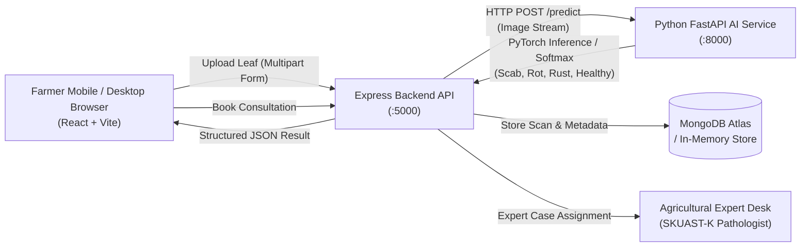

# OrchardSathi AI 🍏
### An AI-Powered Apple Orchard Health and Decision Support System for Kashmir
> **Tagline:** *Smarter Orchards, Healthier Harvests.*  
> **Capstone Phase:** Final-Year Engineering Project — Review 1 Prototype

---

## 1. Project Overview & Regional Context
Apple cultivation is the backbone of the rural economy in Jammu & Kashmir, sustaining over 7 lakh farm families and producing ~20 lakh metric tons annually. However, growers in Shopian, Baramulla, Sopore, and Pulwama face recurrent losses due to:
- Foliar fungal outbreaks (**Apple Scab / *Venturia inaequalis***, **Black Rot / *Botryosphaeria obtusa***, **Cedar Apple Rust**).
- Misdiagnosis and unscientific or delayed fungicide spray applications.
- Opaque wholesale pricing across regional fruit mandis.
- Limited access to certified university plant pathologists and horticulturists.

**OrchardSathi AI** provides a dedicated, role-based platform designed for this ecosystem:
1. **👨‍🌾 Farmer Role (Primary Functional Module in Review 1):** Real-time leaf pathology detection with confidence percentages, SKUAST-K spray calendars, agro-weather infection risk index, private scan history, and direct expert consultation bookings.
2. **🛒 Customer / Trader Role:** Transparent Mandi reference prices (₹/quintal & ₹/box) across Sopore, Shopian, Parimpora, Narwal, and Delhi terminal markets, accompanied by Recharts interactive trend timelines.
3. **🔬 Agricultural Expert Role:** Clinical dashboard for plant pathologists to review farmer-submitted leaf scans, accept appointments, and issue validated treatment assessments.

---

## 2. Technology Stack

| Tier | Technologies |
| :--- | :--- |
| **Frontend** | React 18, Vite 5, Tailwind CSS, React Router v6, Axios, Recharts, Lucide React, Context API |
| **Main Backend** | Node.js, Express.js, JWT Authentication, bcryptjs, Multer (image uploads), Mongoose |
| **Database** | MongoDB Atlas / Local MongoDB (with resilient auto-fallback for offline demo mode) |
| **AI Microservice** | Python 3.10+, FastAPI, PyTorch (`torch`, `torchvision`), Pillow, Uvicorn |
| **Agricultural Data** | Aligned with SKUAST-Kashmir (Sher-e-Kashmir University of Agricultural Sciences and Technology) spray calendars and PlantVillage apple pathology taxonomy |

---

## 3. Architecture Pipeline



---

## 4. Setup & Running Instructions

### Prerequisites
- **Node.js** (v18 or higher recommended; v24 is installed)
- **npm** (v9 or higher)
- **Python** (v3.10 or higher for the optional FastAPI deep learning microservice)
- **MongoDB** (optional: if no URI is supplied, the backend automatically runs in local memory mode for instant review presentations!)

---

### Step A: Start the Express Backend (Port 5000)

1. Open a terminal and navigate to `server/`:
   ```bash
   cd server
   ```
2. Inspect or configure `.env` (a ready-to-run `.env` is already created with sensible defaults):
   ```bash
   PORT=5000
   NODE_ENV=development
   MONGODB_URI=mongodb://127.0.0.1:27017/orchardsathi
   JWT_SECRET=orchardsathi_kashmir_super_secret_jwt_key_2026
   AI_SERVICE_URL=http://localhost:8000
   ```
3. Start the backend:
   ```bash
   npm start
   ```
   *Expected output:*
   ```
   ====================================================
   🍎 OrchardSathi AI — Main Express Backend Active
   📡 URL: http://localhost:5000
   🏥 Health: http://localhost:5000/api/health
   📁 Static Uploads: http://localhost:5000/uploads
   ====================================================
   ```

---

### Step B: Start the React Frontend (Port 5173)

1. In a second terminal, navigate to `client/`:
   ```bash
   cd client
   ```
2. Start the Vite development server:
   ```bash
   npm run dev
   ```
3. Open your browser at:
   ```
   http://localhost:5173
   ```

---

### Step C: (Optional) Start Python FastAPI AI Microservice (Port 8000)

The Express backend seamlessly connects to the FastAPI microservice at `http://localhost:8000/predict`. If the Python microservice is offline, the backend automatically transitions to the built-in diagnostic feature analyzer so your presentation is never interrupted!

To start the FastAPI microservice:
1. Navigate to `ai-service/`:
   ```bash
   cd ai-service
   ```
2. Create and activate a virtual environment:
   ```bash
   python -m venv venv
   # On Windows:
   .\venv\Scripts\activate
   # On Linux/macOS:
   source venv/bin/activate
   ```
3. Install Python dependencies:
   ```bash
   pip install -r requirements.txt
   ```
4. Start Uvicorn:
   ```bash
   uvicorn main:app --reload --port 8000
   ```
5. Interactive API docs: Visit `http://localhost:8000/docs`

---

## 5. Instant Test Accounts (One-Click Demo Switcher)

To make evaluation effortless for faculty examiners, a **"Demo Switcher"** button is integrated directly into the Navbar and Login page:

| Role | Demo Credentials | Workspace Focus |
| :--- | :--- | :--- |
| **👨‍🌾 Farmer** | `farmer.kashmir@orchardsathi.ai` / `Orchard@123` | Leaf disease detection, weather risk, scan history, booking consults |
| **🛒 Customer** | `trader.delhi@orchardsathi.ai` / `Orchard@123` | Kashmiri Mandi wholesale prices (₹/quintal & box), Recharts trends |
| **🔬 Expert** | `expert.altaf@orchardsathi.ai` / `Orchard@123` | Reviewing farmer foliar scans, clinical assessment, appointment acceptance |

---

## 6. Review 1 Feature Matrix: Functional vs. Simulated

| Feature | Review 1 Status | Details |
| :--- | :---: | :--- |
| **Leaf Image Upload & Drag-and-Drop** | ✅ **Fully Functional** | Multer validation, JPG/PNG format checks, 10MB size limit, preview, preset leaf samples |
| **AI Inference & Diagnosis Pipeline** | ✅ **Fully Functional** | Express to FastAPI HTTP connection, classification of Apple Scab, Black Rot, Rust, Healthy Leaf |
| **Confidence-Aware UI** | ✅ **Fully Functional** | Dynamic severity colors, softmax percentage bars, uncertainty alerts when confidence < 75% |
| **SKUAST-K Spray Schedules** | ✅ **Fully Functional** | Authentic stage-specific fungicide recommendations, organic sprays, and preventive cultural advice |
| **Private Farmer Scan History** | ✅ **Fully Functional** | MongoDB persistence, thumbnail storage, user isolation, search, filtering, deletion |
| **Authentication & RBAC** | ✅ **Fully Functional** | JWT tokens, bcrypt password hashing, role-guarded routes (`farmer`, `customer`, `expert`) |
| **Customer Market Trends** | 🟡 **Labelled Demo Data** | Recharts line graphs, wholesale comparisons; clearly labeled as benchmark reference data |
| **Consultation Booking Flow** | ✅ **Fully Functional** | Farmer books linked scan; expert reviews cases, updates status, and enters assessment in MongoDB |
| **Institutional Expert Verification** | 🟡 **Explicit Prototype** | Shows transparent "Pending Verification" badge in compliance with academic guidelines |
| **Orchard Weather Summary** | 🟡 **Sample Forecast** | Realistic Kashmir valley meteorological indicators and Apple Scab infection risk gauge |

---

## 7. Manual Testing Checklist for Review 1

Use this checklist during your faculty project review:

1. **Public Landing Page Navigation:**
   - [ ] Visit `http://localhost:5173`.
   - [ ] Verify brand logo and tagline: *"Smarter Orchards, Healthier Harvests."*
   - [ ] Inspect the three Role Selection cards (Farmer, Customer, Agricultural Expert).
   - [ ] Click "Try Farmer AI Demo" to fast-login.

2. **Farmer Disease Detection Workflow (PRIMARY MODULE):**
   - [ ] Click **"Detect Apple Disease"** from the Farmer dashboard or navbar.
   - [ ] Test the file picker or drag-and-drop zone.
   - [ ] Click any of the **Quick Test Samples** (e.g. *Apple Scab Sample*).
   - [ ] Click **"Analyze Leaf Image"**.
   - [ ] Observe the animated scanning beam and progress steps.
   - [ ] Verify the Result Page displays:
     - Leaf image thumbnail.
     - Disease classification (*Venturia inaequalis*, etc.) with severity badge.
     - Confidence score and probability distribution across all 4 classes.
     - SKUAST-Kashmir organic and chemical spray schedule.
     - Prominent agricultural safety disclaimer.
   - [ ] Click **"Request Expert Review"** to test booking creation with linked scan.
   - [ ] Open **"Scan History"** to verify the new scan is persisted in the database.

3. **Customer Market Trends & Mandi Rates:**
   - [ ] Use the Demo Switcher in Navbar to switch to **Customer** role.
   - [ ] Verify the **"Demo data — not live market prices"** disclaimer badge.
   - [ ] Change the apple variety selector (e.g., from *Kashmiri Delicious* to *Royal Delicious*).
   - [ ] Verify the Recharts timeline chart smoothly re-renders the historical trajectory.
   - [ ] Filter by Mandi (*Sopore*, *Shopian*, *Parimpora*, *Delhi*).
   - [ ] Verify rates are quoted in both ₹/quintal and ₹/standard apple box.

4. **Agricultural Expert Desk:**
   - [ ] Switch to **Agricultural Expert** role.
   - [ ] Verify the **"Pending Verification"** badge is clearly explained.
   - [ ] Toggle consultation availability (Online vs. In-Field).
   - [ ] Review pending farmer booking cases.
   - [ ] Click **"Accept & Confirm"** on a pending case.
   - [ ] Click **"Issue Clinical Assessment"**, enter recommendations, and save.
   - [ ] Verify status updates to *Completed*.

5. **Security & Route Protection:**
   - [ ] Log out.
   - [ ] Try accessing `http://localhost:5173/farmer/detect` directly while logged out.
   - [ ] Verify the user is redirected to `/login`.
   - [ ] Log in as Customer and try navigating to `/farmer/detect`.
   - [ ] Verify the unauthorized access warning card is shown with role boundary explanation.

---

## 8. Directory Structure

```
orchardsathi-ai/
├── client/                     # React + Vite Frontend
│   ├── src/
│   │   ├── components/         # Navbar, Footer, ProtectedRoute, Modals
│   │   ├── context/            # AuthContext (JWT & Role State)
│   │   ├── pages/
│   │   │   ├── LandingPage.jsx
│   │   │   ├── LoginPage.jsx
│   │   │   ├── RegisterPage.jsx
│   │   │   ├── farmer/         # Dashboard, Detection, Result, History
│   │   │   ├── customer/       # Dashboard, MarketPrices
│   │   │   └── expert/         # ExpertDashboard, CaseDetail
│   │   ├── services/           # Axios API Client
│   │   ├── App.jsx             # React Router Configuration
│   │   └── main.jsx
│   ├── package.json
│   ├── tailwind.config.js
│   └── vite.config.js
│
├── server/                     # Node.js + Express Backend
│   ├── config/                 # db.js (Mongoose Connection)
│   ├── controllers/            # auth, scan, market, consultation, expert, weather
│   ├── middleware/             # auth.js (JWT & Role Authorization)
│   ├── models/                 # User.js, Scan.js, Consultation.js, MarketPrice.js
│   ├── routes/                 # Express API Routes
│   ├── services/               # aiService.js (FastAPI client & fallback engine)
│   ├── uploads/                # Static Leaf Photos
│   ├── server.js               # Entry Point
│   ├── package.json
│   └── .env.example
│
├── ai-service/                 # Python FastAPI AI Microservice
│   ├── model/                  # classifier.py (PyTorch transfer-learning backbone)
│   ├── preprocessing/          # transforms.py (Resize, CenterCrop, Normalize)
│   ├── main.py                 # FastAPI Endpoints (/predict, /health, /classes)
│   ├── requirements.txt
│   └── README.md
│
├── package.json                # Monorepo Scripts
└── README.md                   # System Documentation
```

---

*OrchardSathi AI — Final Year Engineering Capstone Project.*  
*Dedicated to the fruit growers of Jammu & Kashmir.*
